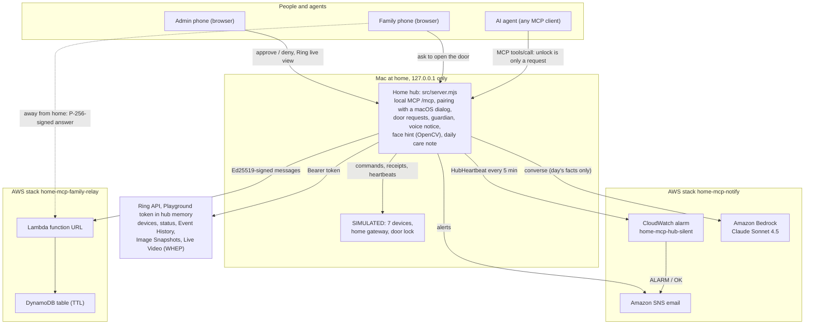
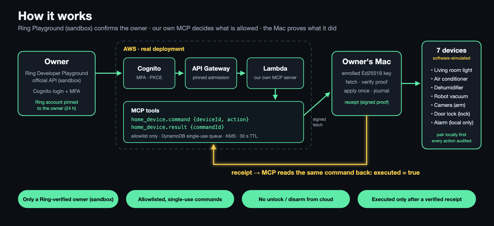

# Home MCP Guardian

**An older parent lives alone; Ring watches the front door. When someone is at the door, when something quietly stops (the camera, the home gateway, the hub itself) or a daily routine step does not happen, the family's phone knows. Opening the door always takes approval on a trusted family phone — the admin phone, with Ring live view on its screen, or a phone the admin enabled for remote approval. An AI agent can only ask.**

Built for the *Build, Ship, Shape: Amazon Developer Hackathon 2026* — **Ring track**, plus the **AWS Builder** mini challenge. (Repository name: `ring-home-mcp-hub`.)

- Demo video (under 3 minutes): _link added after upload_ (earlier version: https://youtu.be/_DTcUaVQPgE)
- License: MIT

| Measured (reproduce with `npm run eval` / `npm run stress`) | Result |
|---|---|
| Gateway outages over 5 min detected (30 simulated days) | **12 / 12**, alert 4.0–4.9 min after it went quiet |
| "Offline" alerts from blips under 3 min (false alarms) | **0 / 22** |
| Emails sent vs. "alert on every missed heartbeat" | **59 vs 765** |
| 100 concurrent MCP unlock calls | **1** request created, door stays locked |
| Same phone credential sent 20 times at once to approve | door opened **once**; that phone is revoked |
| Remote approval through a test relay failing 25 % of calls (`npm run stress`) | **0** wrong outcomes (9 / 10 delivered in the recorded run; the missed one stayed locked) |



More diagrams — door approval with Ring live view, remote approval through the relay, and the guardian states — are in [docs/ARCHITECTURE.md](docs/ARCHITECTURE.md).

---

## Why

Caring for a parent from far away, the scary failure is not "hard to use" but **"we thought it was running and it had stopped long ago"**: the camera went offline and nobody noticed; the light that should come on did not. Many products tell you what happened at the door. This one also tells you **when the guardian itself has stopped**.

And AI agents can now operate things in the home. Our rule is simple: **the AI can only ask; opening the door takes approval on a trusted family phone** — bound to that phone's own key, so an agent holding a signed-in session still cannot approve.

## What it does (Ring at the center)

1. **Ring at the door → family phone approves.** A doorbell press, a person seen at the door, or an AI / family request opens a banner on the admin phone with the **Ring door snapshot**, one-tap **Ring live view** (WebRTC) and an optional face hint. Approve within 60 s to open (door SIMULATED) and get a receipt; the live view and snapshot are closed and dropped as soon as you decide.
2. **Approve from anywhere** *(deployed on AWS, tested end to end 2026-10-16)*. Family phones answer through a small AWS relay. The cloud only passes messages: every decision is signed by that phone's own key and verified again by the hub at home, so the cloud cannot fake an approval.
3. **Three layers of "it stopped" detection:** the Ring camera (Ring device status API), the home gateway (heartbeat every 60 s) and **the hub itself** (Amazon CloudWatch emails when the hub's heartbeat stops). Alerts only on change. When the 30-minute Ring token expires, the family is emailed too; the camera is then shown as SIMULATED until a new token is pasted.
4. **A routine with receipts:** lights, dehumidifier, AC and alarm run on the parent's schedule; each step ends as ✓ confirmed, ✗ not done or ? cannot confirm. Steps missed during an outage are **not** made up silently — the family decides.
5. **The parent hears it:** the Mac speaker says what happened in fixed, plain sentences ("Someone is at the front door. I have asked your family." / "The door stays locked.").
6. **Daily care note** *(Amazon Bedrock, Claude Sonnet 4.5; deployed and tested 2026-10-16)*: written only from the day's log; if the note mentions a time or a number that is not in the log, the family gets a plain template note instead.
7. **AI agents can only ask:** any MCP client (local server `/mcp`, Streamable HTTP, protocol 2025-11-25) calling the door tool gets `pending_approval`; schedules, batches and the cloud cannot unlock.
8. **Pairing without a terminal:** the first phone enters the code shown on the Mac and the Mac shows a system dialog (**Allow**); family phones are allowed from the admin phone. Both sides show the same check digits.
9. **Optional local face hint:** only people who agreed are enrolled; only an encrypted feature is kept (no photo); a hint only — **it never opens the door**.

## What is real and what is simulated

| Part | Status |
|---|---|
| Ring API: devices, device status, Event History, Image Snapshots, **Live Video (WHEP)** | **Real calls** with a Ring Developer Playground token (30 min). Tested 2026-10-16: live view 1280×720 plays inside the approval banner and is closed (`DELETE`, 200) when the request ends; the snapshot works once the camera has streamed (before that, the Playground image URL answers 416 — see the friction log). The Playground has no doorbell-press simulation, so "someone rang" uses an on-screen button labelled SIMULATED |
| How the Ring token reaches the hub | Pasted (masked) into the admin phone's **Ring connection** card; kept in the hub's memory only — never written, logged or echoed. For live view the phone sends only its WebRTC offer; the token stays on the hub |
| Amazon SNS email + CloudWatch dead-man alarm + least-privilege IAM | **Real deployment** (CloudFormation); ALARM and OK emails received |
| AWS family relay (Lambda function URL + its own DynamoDB table + a role limited to that table) | **Real deployment** (CloudFormation stack `home-mcp-family-relay`). Tested 2026-10-16 with `scripts/e2e_live_relay.mjs` (a scripted phone that signs like the `/family` page) against the live URL, 4 recorded runs: approval to door open 2.4–3.2 s (the hub polls the relay every 3 s); a second answer is refused (409); a removed phone is refused. Also exercised from a real phone in the demo video |
| Amazon Bedrock daily note | **Real calls** (Converse, `global.anthropic.claude-sonnet-4-5-20250929-v1:0`, through the notifier's least-privilege profile; permission limited to that model). Without Bedrock, or if the note mentions a number not in the day's log, the hub sends the template note |
| AWS cloud MCP chain: API Gateway, Lambda, Cognito (MFA + PKCE), DynamoDB, KMS, Secrets Manager | **Real deployment** (earlier phase of this project; described below) |
| Phone pairing, approvals, receipts, timeline, local MCP server, voice notice | **Real**, running on the Mac |
| Seven home devices, the home gateway, the door lock | **Software simulations** — no physical device is controlled |
| Face hint | **Real**, on the Mac (OpenCV YuNet + SFace); faces in the video are AI-generated fictional people |
| Physical Ring device | Not used (the rules accept a Ring-documented simulator) |

## Cloud MCP chain (earlier phase): how a command flows



1. **Owner verification (Ring).** The owner signs in with Amazon Cognito (MFA). A Ring Developer Playground token is sent once to `POST /owner/bootstrap`; the Lambda calls Ring `GET /v1/users/me` and compares the SHA-256 of the Ring account id with the pinned owner account (constant-time). A single-use latch and a token replay marker prevent reuse. The association is valid for at most 24 hours.
2. **Mac enrollment.** The owner's Mac has an Ed25519 key. An operator-approved enrollment (`POST /mac/enroll`) binds that key to the owner.
3. **Command.** An MCP client calls `home_device.command {deviceId, action}` on our MCP server (`POST /mcp`, Streamable HTTP). Only the allowlist below is accepted. The command is stored in a single-slot DynamoDB mailbox and lives for 30 seconds.
4. **Execution.** The Mac fetches the command with an Ed25519-signed request proof, checks it, and applies it **once** to a **paired** simulated device in the local console. A device that is not paired, a gateway set offline, or a device fault means *not applied* — cloud commands are never queued for later.
5. **Receipt.** The Mac posts a signed receipt bound to the command id, envelope hash, device and action. Only then does `home_device.result {commandId}` return `status: SUCCEEDED, executed: true`.

### Cloud allowlist (MCP `home_device.command`)

| Device | Actions accepted from the cloud |
|---|---|
| living_light | on, off |
| air_conditioner | on, off |
| dehumidifier | on, off |
| robot_vacuum | start, pause, dock |
| camera | arm |
| front_door | lock |
| alarm_clock | — (local console only) |

**Never accepted from the cloud:** door unlock, camera disarm, any action that takes a value (temperature, humidity, alarm time). The allowlist is checked at three points — the cloud contract, the Mac worker and the local console simulator.

## Where Ring and AWS are called in code

| What | File |
|---|---|
| Ring `GET /v1/users/me` (owner verification, Lambda) | `cloud/aws/ring-private/ring-token-client.mjs`, used by `cloud-owner-bootstrap.mjs` |
| Ring `GET /v1/devices` (read-only discovery, local console) | `src/ring_official_client.mjs` |
| Ring event history probe (read-only) | `src/ring_official_history_client.mjs` |
| Ring Event History watch (doorbell `ding`, person `motion.human`) | `src/ring_doorbell.mjs` |
| Ring device status (camera heartbeat) | `src/server.mjs` (`ringCameraStatus`), `src/guardian.mjs` |
| Ring Image Snapshots (door snapshot) | `src/ring_snapshot.mjs` |
| Ring Live Video (WebRTC WHEP, live view on the approval banner) | `src/ring_live.mjs`, `public/door.mjs` |
| Door requests and approvals | `src/door_requests.mjs`, `public/door.mjs` |
| Family relay (cloud + hub) | `cloud/aws/ring-private/family-relay*.mjs`, `cloud/aws/family-relay/template.json`, `src/remote_relay.mjs` |
| Email alerts / dead-man alarm | `src/notify_sns.mjs`, `cloud/aws/notify/notify-template.json` |
| Daily care note (Bedrock) | `src/care_summary.mjs` |
| Voice notice | `src/voice_notice.mjs` |
| MCP tools `home_device.command` / `home_device.result` | `cloud/aws/ring-private/b02-layer-runtime.mjs`, contract in `src/formal-runtime/mac-command-contract.mjs` |
| Command queue, claim, receipt (DynamoDB) | `cloud/aws/ring-private/mac-command-service.mjs`, `mac-command-store.mjs` |
| Mac worker (fetch / verify / apply / receipt) | `vendor_mac_launcher/` (`mac-worker.mjs`, `vendor/mac-command-worker.mjs`, `vendor/home-device-port.mjs`) |
| Infrastructure | `cloud/aws/ring-private/template.yaml`, `bootstrap-template.yaml` |

## AWS integration (AWS Builder)

| Service | Role in the project |
|---|---|
| Amazon API Gateway (REST, regional, TLS 1.2+ security policy, throttled) | Endpoints used in the demo: `/mcp`, `/auth/*`, `/owner/bootstrap`, `/mac/enroll`, `/mac/commands/fetch`, `/mac/commands/receipt`, `/.well-known/oauth-protected-resource`. Legacy account-link routes (`/ring/token`, `/ring/link`, `/ring/complete`, `/ring/webhook`) are deployed but not part of the demonstrated flow. |
| AWS Lambda (Node.js 24, arm64, AWS SAM) + layer | Earlier phase: our cloud MCP server and the owner / Mac endpoints; the layer holds pinned approval files |
| Amazon Cognito | Owner sign-in: managed login, MFA required, PKCE public client, 5-minute access tokens, MCP resource-server scopes |
| Amazon DynamoDB | Identity links and latches, single-slot command mailbox, receipts, Mac enrollments, proof nonces, anti-rollback witness |
| AWS KMS | Table and secret encryption; Ring account ids are envelope-sealed before storage |
| AWS Secrets Manager | Provider and HMAC digest secrets, pinned to exact versions |
| AWS CloudFormation, Amazon S3, IAM | Gated change-set deployments, pinned build artifacts, least-privilege deployer and runtime roles |
| Amazon SNS + Amazon CloudWatch | Family email alerts; a dead-man alarm that emails when the hub's heartbeat metric stops |
| AWS Lambda function URL (Node.js 22, arm64) + Amazon DynamoDB (stack `home-mcp-family-relay`) | Passes signed approval messages between the hub and enabled phones; table rows expire by TTL; the function's role can only read and write that table |
| Amazon Bedrock (Converse, `global.anthropic.claude-sonnet-4-5-20250929-v1:0`) | Daily care note written from the day's facts only, called through the AWS CLI with the notifier's least-privilege profile (permission limited to that model) |
| Amazon CloudWatch Logs | Log groups for both Lambda functions (relay logs kept 7 days) |

The MCP server also pins its API Gateway id, stage, domain and function in an admission file and checks every request against it; when a request carries a different deployment id it is rejected, so a redeploy requires an explicit re-admission.

---

## Run it locally

Requirements: **macOS** (clipboard import uses `/usr/bin/pbpaste`) and **Node.js ≥ 20.11**. No `npm install` is needed for the local console.

```bash
git clone https://github.com/jiarong0423/ring-home-mcp-hub.git
cd ring-home-mcp-hub
```

The local server listens on **127.0.0.1 only** (default port 8765). Nothing on the internet can connect to it.

### A. Simulator only (no accounts needed)

```bash
npm start
```

Open http://127.0.0.1:8765, log in with the one-time passcode printed in the terminal, pair a device (6-digit simulated code) and control it. All seven devices are simulated; every action is audited.

### A2. Use the console from your phone (pair once)

With the server from A running, the terminal prints `ADMIN phone pairing code: dddd dddd` (10 minutes, single use).

1. Make the phone reach the Mac's loopback port: `adb reverse tcp:8765 tcp:8765` (USB or wireless adb).
2. On the phone open `http://127.0.0.1:8765/`, choose **Pair this phone**, enter the code and a name.
3. The Mac shows a system dialog with the phone's name and two check digits; press **Allow** (the terminal accepts `y` as a fallback). The phone opens the console; from then on it opens directly and stays signed in, and its credential is replaced on every use. It stays trusted until you remove it.
4. Family: on the admin phone press **Add a family phone**; the family phone enters that code, and the **admin phone** shows **Allow / Deny** with the same check digits. Family phones run everyday devices and may **ask** to open the door. At home only the admin phone approves; the admin can also enable a phone (their own or a family member's) for remote approval, see A5. **Remove** revokes a phone immediately.

Pairings are stored as hashes in `~/.home-mcp-console/phones.json` (override with `HOME_MCP_PHONE_STORE`).

### A3. Home guardian for an older relative (low-frequency heartbeats, alerts, daily routine)

The console's **Home guardian** panel (first on the dashboard) watches the Ring camera and the home gateway with low-frequency heartbeats (camera every 5 minutes, gateway every 60 seconds) and runs a daily routine (lights, dehumidifier, AC, alarm) instead of someone pressing buttons remotely. Every run ends as ✓ confirmed (receipt), ✗ not done, or ? cannot confirm; a run missed while the gateway was down is **not** made up automatically — a family member taps **Do it now**. Alerts appear only when something changes (late → offline → back online).

Demo a whole day in minutes (the clock only affects the guardian; codes and sessions keep real time):

```bash
HOME_MCP_CLOCK_SPEED=60 HOME_MCP_CLOCK_START=06:58 npm start
```

Ring camera status is real (`GET /v1/devices/{id}/status`) while a Playground token is loaded: on the admin phone, the **Ring connection** card (top of the page) → **Open Ring Playground** → generate and copy a token → **Paste from clipboard** → **Connect** (about 30 minutes). Without a token the camera is simulated.

**Email alerts (optional, Amazon SNS):** deploy `cloud/aws/notify/notify-template.json` (one SNS topic + email subscription, a CloudWatch alarm that fires when the hub stops sending its heartbeat, and a least-privilege IAM user). Create that user's access key yourself, store it with `aws configure --profile home-mcp-notify`, then start with `HOME_MCP_NOTIFY_SNS_TOPIC_ARN=... HOME_MCP_NOTIFY_AWS_PROFILE=home-mcp-notify`. The hub calls the AWS CLI and never handles the key.

### A4. Opening the door: the AI asks, a trusted phone approves (SIMULATED)

The Ring Partner API has no lock control, so the front door is simulated and labelled SIMULATED everywhere. Opening it never
happens directly. An AI agent over local MCP (`device_front_door` `unlock`), a family phone or the console can only **ask**.
The answer is `pending_approval`. The paired **admin phone** then shows a banner for 60 s with **Approve / Deny** and a Ring door
snapshot. Approving needs that phone's own long-lived credential (kept in the phone's browser), not just a session token, so an
agent holding a session cannot approve itself. A phone enabled for remote approval (A5) can answer the same request from outside the home with its own signing key. One request at a time; single use; expiry, denial and gateway failure are all
recorded on the guardian timeline (email for "someone is asking" and "it was opened", never with the image).

- Snapshot: with a Playground token loaded, the hub calls Ring's Image Snapshots API (`POST /v1/devices/{id}/media/image/download`,
  `latest_in_range`, 303 to a short-lived URL; the Ring token is never sent to that URL). It is kept in memory for the life of the
  request and shown to the admin phone only. Without a token, a stand-in image labelled SIMULATED is shown with the reason.
- **Ring live view:** while a request waits, **Ring live view** on the banner opens a WebRTC stream from Ring (`POST /v1/devices/{id}/media/streaming/whep/sessions`): the phone's browser makes the SDP offer (receive only, no microphone), the hub adds the Ring token and returns Ring's answer. One stream at a time, at most 60 s, closed with `DELETE` when the request is decided or expires. If Ring had no image yet, the snapshot is fetched again a few seconds after the stream starts.
- Cloud, schedules and batches still cannot unlock.
- Optional **face hint** (OpenCV YuNet + SFace, on the Mac): the admin phone may enrol a person (e.g. the carer) only with a
  separate "this person agreed" tick. The hub keeps an AES-256-GCM encrypted 128-number feature, never the photo; delete one
  person or everyone at any time. On a real Ring snapshot the banner then says "looks like <name>" or "not enrolled". It is a
  hint only and never opens the door. Turn it on with `HOME_MCP_FACE_PYTHON` (a Python with `opencv-python-headless` and `numpy`) and
  `HOME_MCP_FACE_MODELS` (folder with `face_detection_yunet_2023mar.onnx` and `face_recognition_sface_2021dec.onnx` from
  opencv_zoo); without them it says "off" and approval works the same.

### A5. Approve from anywhere (AWS family relay, optional)

Deploy `cloud/aws/family-relay/template.json` (parameters: the hub's relay **public** key, printed at start, and the code bundle from `node scripts/build_family_relay_bundle.mjs <dir>`), then start the hub with `HOME_MCP_RELAY_BASE=<RelayBaseUrl output>`. On the admin phone, **Remote approval → Enable remote approval** gives a one-time link (10 minutes) for this phone or a family phone. That phone makes its own key in the browser; the hub confirms it. Door requests then appear on the relay page as text only (who asks, seconds left — never the snapshot), and an approval is verified by the hub with that phone's key before anything opens. The door-request email carries the page link once a phone is enabled. **Remove** on the admin phone stops a phone at once.

### A6. Voice notice and daily care note (optional)

- `HOME_MCP_VOICE=on` (Chinese: `HOME_MCP_VOICE_LANG=zh`): the Mac speaker says what the hub did for the person at home — door requests and decisions, missed routine steps, outages and recoveries. Fixed sentences only; requester text is never read aloud.
- Daily care note: deploy the notify stack with `CareSummaryModelArns` (for a global cross-Region profile give both ARNs: `arn:aws:bedrock:<region>:<account>:inference-profile/global.anthropic.claude-sonnet-4-5-20250929-v1:0,arn:aws:bedrock:*::foundation-model/anthropic.claude-sonnet-4-5-20250929-v1:0`) and start with `HOME_MCP_BEDROCK_MODEL=global.anthropic.claude-sonnet-4-5-20250929-v1:0`. The first use of an Anthropic model in an account needs the Anthropic use case form (Bedrock console) and one call by a principal allowed to subscribe in AWS Marketplace. At `HOME_MCP_SUMMARY_AT` (default 21:00), or when an admin taps **Send today's care note**, the hub emails a short note written by Bedrock from the day's facts (times, devices, actions, outcomes). Sentences that summarise "everything else" are dropped because the log cannot back them; without Bedrock, or if the note mentions a time or a number not in the facts, it sends a plain template note and says so.

### B. Ring Developer Playground, read-only (your own Ring developer account)

```bash
npm run start:ring-playground
```

1. Log in with the printed **demo passcode**.
2. In *Ring official device discovery*, enter the printed **operator code**.
3. In the Ring Developer Playground, generate a token and copy it.
4. Click **Import token from local clipboard** — the token goes straight into server memory; the page never sees it.
5. Enter the operator code again and click **Query Ring devices manually**. You get a de-identified device count; nothing is paired or operated.

Playground tokens expire after about 30 minutes; generate a fresh one if you see HTTP 401.

### C. Full cloud chain (requires your own AWS stack — see below)

```bash
export RING_HUB_API_BASE=https://<api-id>.execute-api.<region>.amazonaws.com/<stage>
export RING_HUB_COGNITO_DOMAIN=https://<domain-prefix>.auth.<region>.amazoncognito.com
export RING_HUB_CLIENT_ID=<public PKCE app client id>
export RING_MAC_STATE_DIR="$HOME/.ring-mac-worker"

# one-time owner ceremony (each step needs its own Cognito login URL)
node vendor_mac_launcher/mac-worker.mjs keygen --owner-ref owner/<you> --association-revision 1
#   -> prints keyId, publicKeySpki and an approvalSkeleton. Add "expiresAt" (epoch ms, at most 24 h ahead),
#      save it as mac-enrollment-approval-v1.json in the Lambda layer and set MacEnrollmentApprovalSha256 to its sha256.
#      The owner approval (owner-bootstrap-approval-v1.json: Cognito sub + SHA-256 of your Ring account id) is pinned the same way
#      via OwnerBootstrapApprovalSha256. `node vendor_mac_launcher/mac-worker.mjs ring-demo` prints that Ring account hash.
node vendor_mac_launcher/mac-worker.mjs login-url        # open the printed URL, sign in, copy the callback URL
RING_PLAYGROUND_TOKEN="<fresh Playground token>" node vendor_mac_launcher/mac-worker.mjs bootstrap --callback-url "<callback URL>"
node vendor_mac_launcher/mac-worker.mjs enroll --callback-url "<callback URL>"

# console with the Cloud MCP panel (asks for the Mac key passphrase, hidden)
npm run start:cloud-panel
```

In the console: pair a device → operator code → **Cognito login** → sign in → paste the callback URL (or read it from the clipboard) → choose e.g. *Living room light — Light on* → **Send to device via cloud**. The steps stream in; the run ends with `Done: result.status=SUCCEEDED, executed=true`. One login is reused by later actions until its token expires (about 5 minutes); press **Cognito login** again after that.

### Tests

```bash
npm test                  # 257 tests: hub, pairing, door approval, live view, family relay, guardian, voice, care note, Ring clients (offline fakes)
npm run eval              # 30 simulated days of outages, blips and routine steps (numbers above)
npm run stress            # 8 stress scenarios against the real server with a deliberately failing fake cloud
npm run test:mac-worker   # Mac worker: keygen, PKCE, signed fetch/receipt, home_device flow against a fake cloud
```

Cloud tests live in `cloud/aws/ring-private/tests` (run `npm ci` there first; some tests need `RING_TRANSPORT_TEST_ROOT=/private/tmp/<dir>`).

## Deploy your own AWS stack (outline)

1. Deploy `cloud/aws/ring-private/bootstrap-template.yaml` (artifact bucket, CloudFormation execution role, runtime role) and create the KMS alias it expects.
2. Build the Lambda artifact (every source file and dependency is SHA-256 pinned) and upload the zip to the artifact bucket:
   ```bash
   (cd cloud/aws/ring-private && npm ci --omit=dev)
   mkdir -p output/isolation/current_runs/build
   cp cloud/aws/ring-private/artifact-pins.json output/isolation/current_runs/build/pins.json
   node scripts/build_ring_private_artifact.mjs --root "$PWD" --out "$PWD/output/isolation/current_runs/build/artifact" --pins "$PWD/output/isolation/current_runs/build/pins.json"
   (cd output/isolation/current_runs/build/artifact && zip -qrX ../lambda.zip .)
   ```
   The builder refuses any file whose hash differs from the pins; regenerate `artifact-pins.json` (and the `FIXED` list in the builder) if you change the code.
3. Deploy `cloud/aws/ring-private/template.yaml` with public ingress disabled, store the secret values and pin their version ids.
4. Enable ingress, build the gateway admission file for the live API id / stage / deployment, publish the layer, and set the approval hashes and state parameters.
5. Create the single Cognito owner user (MFA), then run the owner ceremony from section C.

Everything account-specific (account id, region, API id, Cognito ids, Ring account pin, Mac key) is a parameter — nothing is hard-coded.

## Security model

- **Owner only:** Cognito MFA + PKCE, plus a Ring account pinned to the owner; single owner, admin-created users only.
- **Short-lived by design:** 5-minute access tokens, 30-second commands, owner association and Mac enrollment approvals of at most 24 hours.
- **Single use:** idempotent command ids, one command in flight per owner, single-use approval latches, Ring token replay markers, proof nonces.
- **Evidence, not acceptance:** `executed=true` requires a receipt that matches the claim token, envelope hash, enrolled Mac key and the exact device/action.
- **Door safety:** no unlock or disarm from the cloud; opening is a request that only the admin phone (its own rotating credential) or a relay-enabled phone (its own signing key, verified at home) can approve; a reused phone credential revokes that phone.
- **Local isolation:** the console binds to 127.0.0.1, requires a separate operator code for every Ring action and once per cloud login (rate-limited), and never sends tokens, codes or the Mac key passphrase to the browser. The Mac worker only makes outbound requests — it opens no inbound port.

See `SECURITY.md` and `THREAT_MODEL.md`.

## Limitations (honest scope)

- The Ring side uses the **Ring Developer Playground sandbox**; production Ring account linking (and so webhooks and refresh tokens) was not available to our account, so the hub polls Event History every 10 s while a 30-minute Playground token is loaded.
- The family relay and the Bedrock note are optional; until deployed, approval works from the admin phone at home and the daily note is the template.
- The seven home devices are **software simulations**; six accept allowlisted cloud actions.
- The Mac worker runs in **software-direct, reduced-assurance mode** (no local Wi-Fi trust or anti-rollback re-check on the Mac).
- Approvals are short-lived and renewed by an operator ceremony; there is no automatic renewal yet.
- Some legacy modules from earlier iterations (e.g. `telegram-*`, account-link routes) remain in the code but are not part of the demonstrated flow.

## Product feedback for Ring

Full write-up in the Devpost submission and [docs/FRICTION_LOG.md](docs/FRICTION_LOG.md); highlights: Playground tokens last ~30 minutes and cannot be refreshed; the Playground has no doorbell-press simulation and its simulated motion is video content, not Event History; the snapshot image URL answers 416 until the camera has streamed; account linking was unavailable for a non-US developer account. WHEP live view worked first time following Ring's hello-world sample.

## Built during the hackathon

Started on 2026-09-29, inside the submission window.

## License

MIT — see [LICENSE](LICENSE).
