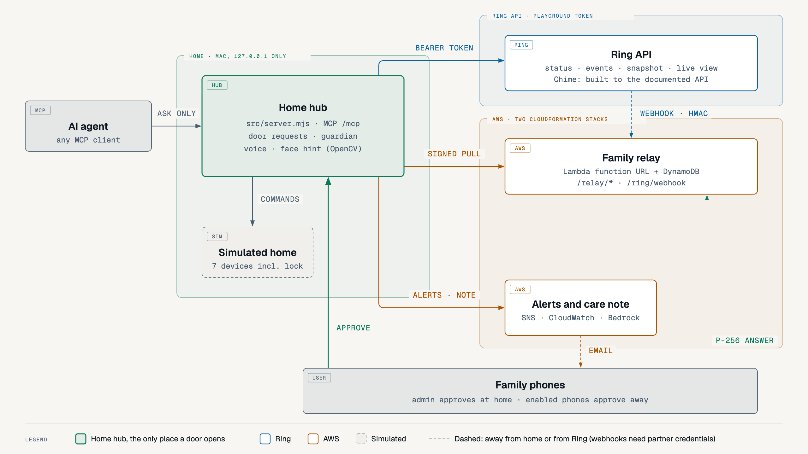
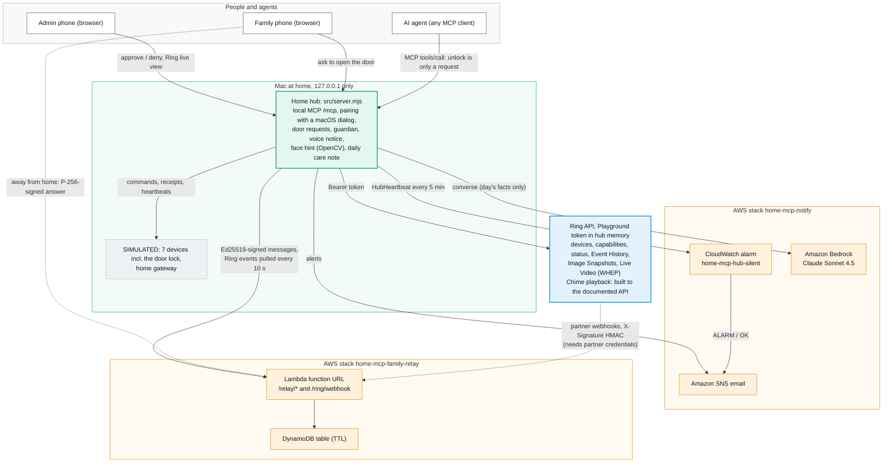

# Home MCP Guardian

[](https://github.com/jiarong0423/ring-home-mcp-hub/actions/workflows/ci.yml)

**An older parent lives alone; Ring watches the front door. When someone is at the door, when something quietly stops (the camera, the home gateway, the hub itself) or a daily routine step does not happen, the family's phone knows. Opening the door always takes approval on a trusted family phone — the admin phone, with Ring live view on its screen, or a phone the admin enabled for remote approval. An AI agent can only ask.**



Built for the *Build, Ship, Shape: Amazon Developer Hackathon 2026* — **Ring track**, plus the **AWS Builder** and **Open Source** mini challenges. (Repository name: `ring-home-mcp-hub`.)

- Demo video (2:55): https://youtu.be/h2szo1nPgxw
- License: MIT
- Open-source companion: [ring-webhook-mailbox](https://github.com/jiarong0423/ring-webhook-mailbox), the same webhook receiver as in [A5](#a5-approve-from-anywhere-aws-family-relay-optional), extracted as its own MIT project with a simple pull API (`POST /pull`), for any hub without a public address

## Try it in 2 minutes (judges)

Needs only a Mac with Node.js ≥ 20.11. No accounts, no `npm install`, no phone; every device is simulated.

```bash
git clone https://github.com/jiarong0423/ring-home-mcp-hub.git
cd ring-home-mcp-hub
npm run eval
HOME_MCP_CLOCK_SPEED=60 HOME_MCP_CLOCK_START=06:58 npm start
```

1. `npm run eval` (about 30 s) replays 30 simulated days and prints the guardian numbers in the table below.
2. `npm start` runs a home day at 60× speed (one home hour per real minute). Open http://127.0.0.1:8765 and log in with the one-time passcode printed in the terminal.
3. **Ring home guardian** panel: the 07:00 light step shows ✗ not done, because the light is not paired yet. Under **Devices**, press **Simulate pairing** on *Living room light* and type the 6-digit code shown.
4. Press **Demo: gateway offline**. Within seconds the timeline shows "heartbeat late", then "offline". Steps due while it is down stay ✗ not done; nothing is made up on its own. Press **Demo: gateway back**, then **Do it now** on a missed step: ✓ confirmed.
5. Press **Send today's care note**. Without AWS it shows the plain template note and says so.

Optional, in order of effort: the door approval flow with a paired phone and Ring live view (A2, A4), email alerts (A3), remote approval through AWS (A5), the Bedrock care note and voice notice (A6). See [Run it locally](#run-it-locally).

| Measured (reproduce with `npm run eval` / `npm run stress`) | Result |
|---|---|
| Gateway outages over 5 min detected (30 simulated days) | **12 / 12**, alert 4.0–4.9 min after it went quiet |
| "Offline" alerts from blips under 3 min (false alarms) | **0 / 22** |
| Emails sent vs. "alert on every missed heartbeat" | **59 vs 765** |
| 100 concurrent MCP unlock calls | **1** request created, door stays locked |
| Same phone credential sent 20 times at once to approve | door opened **once**; that phone is revoked |
| Remote approval through a test relay failing 25 % of calls (`npm run stress`) | **0** wrong outcomes (9 / 10 delivered in our run on 2026-10-16; the missed one stayed locked) |



More diagrams — door approval with Ring live view, remote approval through the relay, the guardian states, and Ring webhooks and Chime — are in [docs/ARCHITECTURE.md](docs/ARCHITECTURE.md).

---

## Why

Caring for a parent from far away, the scary failure is not "hard to use" but **"we thought it was running and it had stopped long ago"**: the camera went offline and nobody noticed; the light that should come on did not. Many products tell you what happened at the door. This one also tells you **when the guardian itself has stopped**.

And AI agents can now operate things in the home. Our rule is simple: **the AI can only ask; opening the door takes approval on a trusted family phone** — bound to that phone's own key, so an agent holding a signed-in session still cannot approve.

## What it does (Ring at the center)

1. **Ring at the door → family phone approves.** A doorbell press, a person seen at the door (Ring Event History, or Ring webhooks through the relay), or an AI / family request opens a banner on the admin phone with the **Ring door snapshot**, one-tap **Ring live view** (WebRTC) and an optional face hint. Approve within 60 s to open (door SIMULATED) and get a receipt; the live view and snapshot are closed and dropped as soon as you decide.
2. **Approve from anywhere** *(deployed on AWS, tested end to end 2026-10-16)*. Family phones answer through a small AWS relay. The cloud only passes messages: every decision is signed by that phone's own key and verified again by the hub at home, so the cloud cannot fake an approval.
3. **Three layers of "it stopped" detection:** the Ring camera (Ring device status API), the home gateway (heartbeat every 60 s) and **the hub itself** (Amazon CloudWatch emails when the hub's heartbeat stops). Alerts only on change. When the 30-minute Ring token expires, the family is emailed too; the camera is then shown as SIMULATED until a new token is pasted.
4. **A routine that reports back:** lights, dehumidifier, AC and alarm run on the parent's schedule; each step ends as ✓ confirmed, ✗ not done or ? cannot confirm. Steps missed during an outage are **not** made up silently — the family decides.
5. **The parent hears it:** the Mac speaker says what happened in fixed, plain sentences ("Someone is at the front door. I have asked your family." / "The door stays locked."); when the home has a Ring Chime, it sounds at the same moments (Chime playback API, skipped when offline or snoozed).
6. **Daily care note** *(Amazon Bedrock, Claude Sonnet 4.5; deployed and tested 2026-10-16)*: written only from the day's log; if the note mentions a time or a number that is not in the log, the family gets a plain template note instead.
7. **AI agents can only ask:** any MCP client (local server `/mcp`, Streamable HTTP, protocol 2025-11-25) calling the door tool gets `pending_approval`; schedules, batches and the cloud cannot unlock.
8. **Pairing without a terminal:** the first phone enters the code shown on the Mac and the Mac shows a system dialog (**Allow**); family phones are allowed from the admin phone. Both sides show the same check digits.
9. **Optional local face hint:** only people who agreed are enrolled; only an encrypted feature is kept (no photo); a hint only — **it never opens the door**.

## What is real and what is simulated

| Part | Status |
|---|---|
| Ring API: devices, device status, Event History, Image Snapshots, **Live Video (WHEP)** | **Real calls** with a Ring Developer Playground token (30 min). Tested 2026-10-16: live view 1280×720 plays inside the approval banner and is closed (`DELETE`, 200) when the request ends; the snapshot works once the camera has streamed (before that, the Playground image URL answers 416 — see the friction log). The Playground has no doorbell-press simulation, so "someone rang" uses an on-screen button labelled SIMULATED |
| How the Ring token reaches the hub | Pasted (masked) into the admin phone's **Ring connection** card; kept in the hub's memory only — never written, logged or echoed. For live view the phone sends only its WebRTC offer; the token stays on the hub |
| Amazon SNS email + CloudWatch dead-man alarm + least-privilege IAM | **Real deployment** (CloudFormation); ALARM and OK emails received |
| AWS family relay (Lambda function URL + its own DynamoDB table + a role limited to that table) | **Real deployment** (CloudFormation stack `home-mcp-family-relay`). Tested 2026-10-16 with `scripts/e2e_live_relay.mjs` (a scripted phone that signs like the `/family` page) against the live URL, 4 runs on 2026-10-16: approval to door open 2.4–3.2 s (the hub polls the relay every 3 s); a second answer is refused (409); a removed phone is refused. Also exercised from a real phone in the demo video |
| Amazon Bedrock daily note | **Real calls** (Converse, `global.anthropic.claude-sonnet-4-5-20250929-v1:0`, through the notifier's least-privilege profile; permission limited to that model). Without Bedrock, or if the note mentions a number not in the day's log, the hub sends the template note |
| Earlier phase: cloud MCP chain on API Gateway, Lambda, Cognito, DynamoDB, KMS, Secrets Manager | **Real deployment**, still running, not in the video; see [docs/EARLIER_PHASE_CLOUD_MCP.md](docs/EARLIER_PHASE_CLOUD_MCP.md) |
| Phone pairing, approvals, receipts, timeline, local MCP server, voice notice | **Real**, running on the Mac |
| Seven home devices (incl. the door lock) and the home gateway | **Software simulations** — no physical device is controlled |
| Face hint | **Real**, on the Mac (OpenCV YuNet + SFace); faces in the video are AI-generated fictional people |
| Ring partner webhooks (relay `POST /ring/webhook`) | **Real deployment** on the relay stack; HMAC check, de-duplication and the hub's pull tested in a live run on 2026-10-16: signed test events shaped like Ring's documented examples were sent from AWS CloudShell to the live URL (reproduce with `scripts/live_webhook_test_cloudshell.sh`); 3 events reached the hub in 0.7–2.5 s, a repeat was dropped, and on the full hub a doorbell event became a door request and `device_offline` / `device_online` changed the camera state. Real Ring deliveries need partner credentials with account linking, which our account does not have |
| Ring Chime announcements | Device discovery and capabilities ran on the real Ring API (our Playground account has one camera and no Chime, so the hub logs `no_chime`); playback, snooze and offline handling are tested against the documented responses (`tests/ring_chime.mjs`) |
| Physical Ring device | Not used (the rules accept a Ring-documented simulator) |

## Where Ring and AWS are called in code

| What | File |
|---|---|
| Ring `GET /v1/devices` (read-only discovery) | `src/ring_official_client.mjs` |
| Ring event history probe (read-only) | `src/ring_official_history_client.mjs` |
| Ring Event History watch (doorbell `ding`, person `motion.human`) | `src/ring_doorbell.mjs` |
| Ring device status (camera heartbeat) | `src/server.mjs` (`ringCameraStatus`), `src/guardian.mjs` |
| Ring Image Snapshots (door snapshot) | `src/ring_snapshot.mjs` |
| Ring Live Video (WebRTC WHEP, live view on the approval banner) | `src/ring_live.mjs`, `public/door.mjs` |
| Ring Chime (capabilities, status, configurations, audio playback) | `src/ring_chime.mjs` |
| Ring partner webhooks (receiver on the relay, pull on the hub) | `cloud/aws/ring-private/family-relay.mjs` (`ringWebhook`, op `ringEvents`), `family-relay-http.mjs`, `src/remote_relay.mjs` (`pullRingEvents`), `src/server.mjs` (`onRingWebhookEvent`) |
| Door requests and approvals | `src/door_requests.mjs`, `public/door.mjs` |
| Family relay (cloud + hub) | `cloud/aws/ring-private/family-relay*.mjs`, `cloud/aws/family-relay/template.json`, `src/remote_relay.mjs` |
| Email alerts / dead-man alarm | `src/notify_sns.mjs`, `cloud/aws/notify/notify-template.json` |
| Daily care note (Bedrock) | `src/care_summary.mjs` |
| Voice notice | `src/voice_notice.mjs` |

## AWS integration (AWS Builder)

| Service | Role in the project |
|---|---|
| Amazon SNS + Amazon CloudWatch (stack `home-mcp-notify`) | Family email alerts; a dead-man alarm (`home-mcp-hub-silent`) that emails when the hub's heartbeat metric stops |
| Amazon Bedrock (Converse, `global.anthropic.claude-sonnet-4-5-20250929-v1:0`) | Daily care note written from the day's facts only, called through the AWS CLI with the notifier's least-privilege profile (permission limited to that model) |
| AWS Lambda function URL (Node.js 22, arm64) + Amazon DynamoDB (stack `home-mcp-family-relay`) | Passes signed approval messages between the hub and enabled phones, and receives Ring webhooks for the hub (`POST /ring/webhook`, X-Signature HMAC); table rows expire by TTL |
| AWS IAM | Least-privilege roles: the relay function can only read and write its own table and log group; the notifier user can only publish to its topic, put its metric and call that one model |
| AWS CloudFormation, Amazon S3 | Both stacks are CloudFormation templates; the relay's code bundle is uploaded to S3 |
| Amazon CloudWatch Logs | Relay function logs, kept 7 days |
| Amazon Polly | Narration voice of the demo video (not used by the hub) |

Earlier phase (still deployed, not in the video): a cloud MCP chain on API Gateway, Lambda, Cognito, DynamoDB, KMS and Secrets Manager — see [docs/EARLIER_PHASE_CLOUD_MCP.md](docs/EARLIER_PHASE_CLOUD_MCP.md).

---

## Run it locally

Requirements: **macOS** (clipboard import uses `/usr/bin/pbpaste`) and **Node.js ≥ 20.11**. No `npm install` is needed for the local console.

```bash
git clone https://github.com/jiarong0423/ring-home-mcp-hub.git
cd ring-home-mcp-hub
```

The local server listens on **127.0.0.1 only** (default port 8765). Nothing on the internet can connect to it.

### A. Simulator only (no accounts needed)

```bash
npm start
```

Open http://127.0.0.1:8765, log in with the one-time passcode printed in the terminal, pair a device (6-digit simulated code) and control it. All seven devices (incl. the door lock) are simulated; every action is audited.

### A2. Use the console from your phone (pair once)

With the server from A running, the terminal prints `ADMIN phone pairing code: dddd dddd` (10 minutes, single use).

1. Make the phone reach the Mac's loopback port: `adb reverse tcp:8765 tcp:8765` (USB or wireless adb).
2. On the phone open `http://127.0.0.1:8765/`, choose **Pair this phone**, enter the code and a name.
3. The Mac shows a system dialog with the phone's name and two check digits; press **Allow** (the terminal accepts `y` as a fallback). The phone opens the console; from then on it opens directly and stays signed in, and its credential is replaced on every use. It stays trusted until you remove it.
4. Family: on the admin phone press **Add a family phone**; the family phone enters that code, and the **admin phone** shows **Allow / Deny** with the same check digits. Family phones run everyday devices and may **ask** to open the door. At home only the admin phone approves; the admin can also enable a phone (their own or a family member's) for remote approval, see A5. **Remove** revokes a phone immediately.

Pairings are stored as hashes in `~/.home-mcp-console/phones.json` (override with `HOME_MCP_PHONE_STORE`).

### A3. Home guardian for an older relative (low-frequency heartbeats, alerts, daily routine)

The console's **Ring home guardian** panel (first on the dashboard) watches the Ring camera and the home gateway with low-frequency heartbeats (camera every 5 minutes, gateway every 60 seconds) and runs a daily routine (lights, dehumidifier, AC, alarm) instead of someone pressing buttons remotely. Every run ends as ✓ confirmed (receipt), ✗ not done, or ? cannot confirm; a run missed while the gateway was down is **not** made up automatically — a family member taps **Do it now**. Alerts appear only when something changes (late → offline → back online).

Demo a whole day in minutes (the clock only affects the guardian; codes and sessions keep real time):

```bash
HOME_MCP_CLOCK_SPEED=60 HOME_MCP_CLOCK_START=06:58 npm start
```

Ring camera status is real (`GET /v1/devices/{id}/status`) while a Playground token is loaded: on the admin phone, the **Ring connection** card (top of the page) → **Open Ring Playground** → generate and copy a token → **Paste from clipboard** → **Connect** (about 30 minutes). Without a token the camera is simulated.

**Email alerts (optional, Amazon SNS):** deploy `cloud/aws/notify/notify-template.json` (one SNS topic + email subscription, a CloudWatch alarm that fires when the hub stops sending its heartbeat, and a least-privilege IAM user). Create that user's access key yourself, store it with `aws configure --profile home-mcp-notify`, then start with `HOME_MCP_NOTIFY_SNS_TOPIC_ARN=... HOME_MCP_NOTIFY_AWS_PROFILE=home-mcp-notify`. The hub calls the AWS CLI and never handles the key.

### A4. Opening the door: the AI asks, a trusted phone approves (SIMULATED)

The Ring Partner API has no lock control, so the front door is simulated and labelled SIMULATED everywhere. Opening it never
happens directly. An AI agent over local MCP (`device_front_door` `unlock`), a family phone or the console can only **ask**.
The answer is `pending_approval`. The paired **admin phone** then shows a banner for 60 s with **Approve / Deny** and a Ring door
snapshot. Approving needs that phone's own long-lived credential (kept in the phone's browser), not just a session token, so an
agent holding a session cannot approve itself. A phone enabled for remote approval (A5) can answer the same request from outside the home with its own signing key. One request at a time; single use; expiry, denial and gateway failure are all
recorded on the guardian timeline (email for "someone is asking" and "it was opened", never with the image).

- Snapshot: with a Playground token loaded, the hub calls Ring's Image Snapshots API (`POST /v1/devices/{id}/media/image/download`,
  `latest_in_range`, 303 to a short-lived URL; the Ring token is never sent to that URL). It is kept in memory for the life of the
  request and shown to the admin phone only. Without a token, a stand-in image labelled SIMULATED is shown with the reason.
- **Ring live view:** while a request waits, **Ring live view** on the banner opens a WebRTC stream from Ring (`POST /v1/devices/{id}/media/streaming/whep/sessions`): the phone's browser makes the SDP offer (receive only, no microphone), the hub adds the Ring token and returns Ring's answer. One stream at a time, at most 60 s, closed with `DELETE` when the request is decided or expires. If Ring had no image yet, the snapshot is fetched again a few seconds after the stream starts.
- Cloud, schedules and batches still cannot unlock.
- Optional **face hint** (OpenCV YuNet + SFace, on the Mac): the admin phone may enrol a person (e.g. the carer) only with a
  separate "this person agreed" tick. The hub keeps an AES-256-GCM encrypted 128-number feature, never the photo; delete one
  person or everyone at any time. On a real Ring snapshot the banner then says "looks like <name>" or "not enrolled". It is a
  hint only and never opens the door. Turn it on with `HOME_MCP_FACE_PYTHON` (a Python with `opencv-python-headless` and `numpy`) and
  `HOME_MCP_FACE_MODELS` (folder with `face_detection_yunet_2023mar.onnx` and `face_recognition_sface_2021dec.onnx` from
  opencv_zoo); without them it says "off" and approval works the same.

### A5. Approve from anywhere (AWS family relay, optional)

Deploy `cloud/aws/family-relay/template.json` (parameters: the hub's relay **public** key, printed at start, and the code bundle from `node scripts/build_family_relay_bundle.mjs <dir>`), then start the hub with `HOME_MCP_RELAY_BASE=<RelayBaseUrl output>`. On the admin phone, **Remote approval → Enable remote approval** gives a one-time link (10 minutes) for this phone or a family phone. That phone makes its own key in the browser; the hub confirms it. Door requests then appear on the relay page as text only (who asks, seconds left — never the snapshot), and an approval is verified by the hub with that phone's key before anything opens. The door-request email carries the page link once a phone is enabled. **Remove** on the admin phone stops a phone at once.

**Ring webhooks through the same relay (optional).** A hub at home sits behind NAT, so it cannot receive Ring's webhooks itself. The relay's `POST /ring/webhook` is the public HTTPS endpoint: it checks the documented `X-Signature` (`sha256=` + HMAC-SHA256 of the raw body, with the HMAC key issued with your Ring partner credentials), drops repeats by `meta.request_id`, answers quickly (Ring expects a reply within 5 seconds; the work is a few table reads and writes), and keeps only the event type, sub-type, device id and time (no thumbnails, no account id). Start the hub with `HOME_MCP_RING_WEBHOOKS=on` and it pulls the queue every 10 s over its signed channel; the first pull only notes the position, so older events never open anything. `button_press`, `person_detected` and human `motion_detected` become door requests while fresh (2 minutes); `device_offline` / `device_online` change the guardian's camera state at once (one email each way). Deploy with `RingWebhookHmacKey` (NoEcho; empty = the route answers 503). Receiving real Ring webhooks needs Ring partner credentials with account linking, which our developer account does not have, so this path is tested with payloads shaped like the documented examples (`tests/remote_relay.mjs`, `cloud/aws/ring-private/tests/family-relay.test.mjs`) and in a live run on 2026-10-16 with signed test events sent from AWS CloudShell (reproduce with `scripts/live_webhook_test_cloudshell.sh`) to the live relay. The same webhook receiver, extracted as its own MIT project with a simple pull API (`POST /pull` instead of the relay's signed `ringEvents` op): [ring-webhook-mailbox](https://github.com/jiarong0423/ring-webhook-mailbox).

### A6. Voice notice and daily care note (optional)

- `HOME_MCP_CHIME=on`: while a Ring token is loaded, a Ring Chime in the home sounds at the same moments as the voice notice, so the person hears it anywhere in the house. The hub finds the Chime from the documented device capabilities (`audio.customizable_slots`), skips it when it is offline or snoozed, and plays the first enabled slot's `audio_ref` (`POST /v1/devices/{id}/media/audio/playback`); otherwise only the Mac speaks.
- `HOME_MCP_VOICE=on` (Chinese: `HOME_MCP_VOICE_LANG=zh`): the Mac speaker says what the hub did for the person at home — door requests and decisions, missed routine steps, outages and recoveries. Fixed sentences only; requester text is never read aloud.
- Daily care note: deploy the notify stack with `CareSummaryModelArns` (for a global cross-Region profile give both ARNs: `arn:aws:bedrock:<region>:<account>:inference-profile/global.anthropic.claude-sonnet-4-5-20250929-v1:0,arn:aws:bedrock:*::foundation-model/anthropic.claude-sonnet-4-5-20250929-v1:0`) and start with `HOME_MCP_BEDROCK_MODEL=global.anthropic.claude-sonnet-4-5-20250929-v1:0`. The first use of an Anthropic model in an account needs the Anthropic use case form (Bedrock console) and one call by a principal allowed to subscribe in AWS Marketplace. At `HOME_MCP_SUMMARY_AT` (default 21:00), or when an admin taps **Send today's care note**, the hub emails a short note written by Bedrock from the day's facts (times, devices, actions, outcomes). Sentences that summarise "everything else" are dropped because the log cannot back them; without Bedrock, or if the note mentions a time or a number not in the facts, it sends a plain template note and says so.

### A7. Other home devices: what an AI agent may do on its own, vacuum reports, a real gateway (optional)

- **Tiered permissions for AI agents** (`src/agent_policy.mjs`). An MCP client may run low-risk actions inside the family's limits at once; everything else is refused before it reaches a device and shows on the guardian timeline ("an AI agent asked for … ; refused"). Family phones are not limited. The refusal returns the whole policy, so an agent can stay inside it.

  | Device | AI agent may do on its own | Family only | Ask (a trusted phone decides) |
  |---|---|---|---|
  | Living room light | on, off | | |
  | Air conditioner | on, off, temperature 24–28 °C | other temperatures | |
  | Dehumidifier | on, off, target 40–60 % | other targets | |
  | Robot vacuum | start 08:00–20:00, pause, dock | start at night | |
  | Alarm clock | set between 05:00 and 10:00 | other times, clear | |
  | Ring camera (simulated arm state) | arm | disarm | |
  | Front door (SIMULATED) | lock | | unlock |

- **The robot vacuum reports back** (SIMULATED). A run started from anywhere (console, family phone, AI agent) is followed to one result: done and back on the dock (with a receipt), needs help (stuck or battery low: one email), or cannot confirm (the gateway was down when it should have reported) — never assumed done. **Demo: vacuum gets stuck** on the guardian panel shows the alert.
- **A real home gateway on USB** (`HOME_MCP_USB_GATEWAY=on`, `firmware/home_gateway`). An ESP32-C3 sends one heartbeat a minute over USB (no Wi-Fi, no credentials; the hub still listens on 127.0.0.1 only), so unplugging it is a real outage: late after 3 min, offline after 5 min, one email each way. Its BOOT button is the parent's button: a short press says "I'm OK" (timeline), a long press asks the family for help (email and voice notice). The hub only opens USB serial ports whose USB device is made by Espressif (vendor id 0x303a, from macOS `ioreg`) or the one port named in `HOME_MCP_USB_GATEWAY_PORT`, so a monitor's control port or a phone is never touched; of those, it only uses a board that says hello with the id `hmg-home-gateway`, and another ESP32 is asked once for its identity and closed. Build and flash: `arduino-cli compile --fqbn esp32:esp32:esp32c3:CDCOnBoot=cdc firmware/home_gateway`, then `arduino-cli upload -p /dev/cu.usbmodem<N> --fqbn esp32:esp32:esp32c3:CDCOnBoot=cdc firmware/home_gateway`. Verified on a real ESP32-C3 on 2026-10-17: hello and a heartbeat every 60 s, short and long presses on the timeline, unplugged -> heartbeat late at 3 min and offline at 5 min, plugged back in -> recovered (the automated tests use fake ports).

### Tests

```bash
npm test                  # 279 tests (2 face-hint tests skip when the models are absent): hub, pairing, door approval, live view, family relay, Ring webhooks, Ring Chime, guardian, AI permissions, vacuum reports, USB gateway, email alerts, voice, care note, Ring clients (offline fakes)
npm run eval              # 30 simulated days of outages, blips and routine steps (numbers above)
npm run check:claims      # re-runs the eval and both test suites; fails if any number in this README differs (also run in CI)
npm run stress            # 8 stress scenarios against the real server with a deliberately failing fake cloud
npm run test:mac-worker   # 40 tests, earlier phase only: the Mac worker of the cloud MCP chain (against a fake cloud)
```

Cloud tests live in `cloud/aws/ring-private/tests` (run `npm ci` there first; some tests need `RING_TRANSPORT_TEST_ROOT=/private/tmp/<dir>`).

## Security model

- **Door safety:** no unlock or disarm from the cloud, schedules or batches; opening is a request that only the admin phone (its own rotating credential) or a relay-enabled phone (its own signing key, verified at home) can approve; one request at a time, 60 s, single use.
- **Relay signatures:** every hub call to the relay is signed with the hub's Ed25519 key (public key pinned in the stack); a remote phone signs its answer with its own P-256 key made in the browser, and the hub verifies it again at home, so the relay cannot fake an approval; a second answer is refused.
- **Phone credential rotation:** the admin phone's credential is replaced on every use; presenting an old one means a copy exists, so that phone is revoked; **Remove** revokes a phone at once.
- **Local isolation:** the hub binds to 127.0.0.1 and rejects requests whose Host or Origin is not the local address; Ring actions from a desktop session need a separate operator code (the admin phone stands in); Ring tokens are kept in hub memory and never sent to the browser.
- **Webhook HMAC:** the relay accepts a Ring webhook only with a valid `X-Signature` (HMAC-SHA256 of the raw body, constant-time compare), drops repeats by `meta.request_id`, and answers 503 until the HMAC key is set.

See [SECURITY.md](SECURITY.md) and [THREAT_MODEL.md](THREAT_MODEL.md).

## Limitations (honest scope)

- The Ring side uses the **Ring Developer Playground sandbox**; production Ring account linking (and so webhooks and refresh tokens) was not available to our account, so the hub polls Event History every 10 s while a 30-minute Playground token is loaded. The webhook mailbox is deployed and tested with signed events in the documented format, but has not received a real Ring delivery; Chime playback has not run on a real Chime.
- The family relay and the Bedrock note are optional; until deployed, approval works from the admin phone at home and the daily note is the template.
- The seven home devices (incl. the door lock) are **software simulations**.

## Product feedback for Ring

Full write-up in the Devpost submission and [docs/FRICTION_LOG.md](docs/FRICTION_LOG.md); highlights: Playground tokens last ~30 minutes and cannot be refreshed; the Playground has no doorbell-press simulation and its simulated motion is video content, not Event History; the snapshot image URL answers 416 until the camera has streamed; account linking was unavailable for a non-US developer account; webhooks need a public HTTPS endpoint, which a home hub does not have; the Playground has no Chime. WHEP live view worked first time following Ring's hello-world sample.

## Built during the hackathon

Started on 2026-09-29, inside the submission window.

## License

MIT — see [LICENSE](LICENSE).
