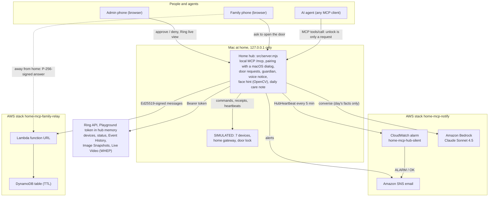
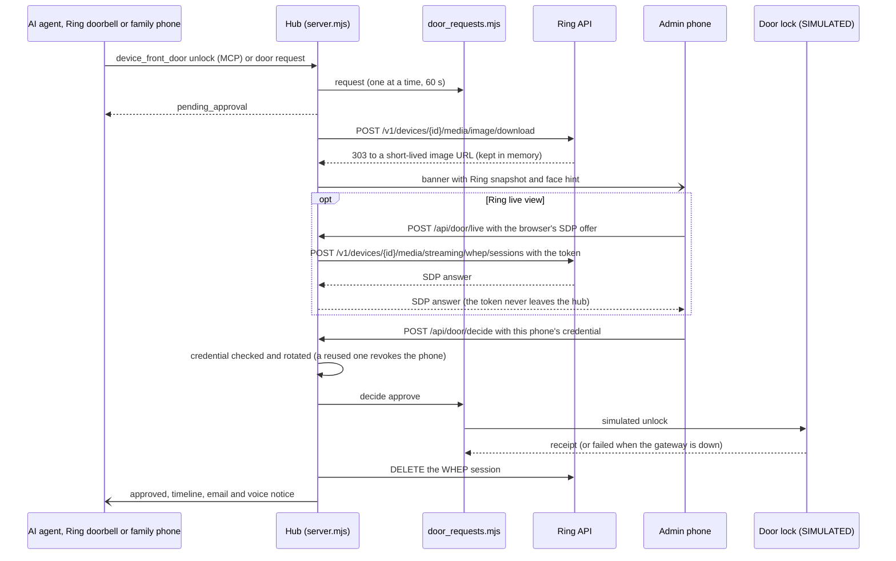
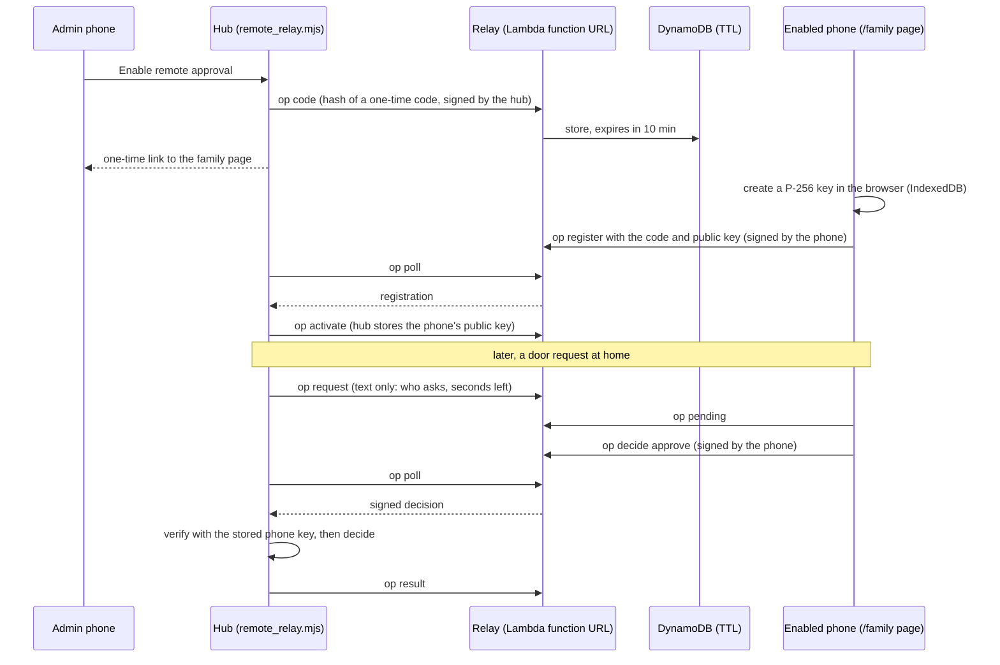
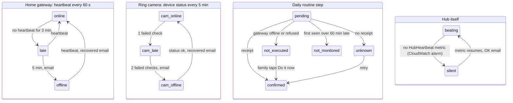

# Architecture

Four views of Home MCP Guardian, kept in sync with the code (file names in the boxes are real). GitHub renders these Mermaid diagrams directly.

1. [System](#1-system) — what runs where
2. [Door approval](#2-door-approval) — the AI asks, a phone decides, Ring live view on the banner
3. [Remote approval](#3-remote-approval-family-relay) — approving from outside the home through the AWS family relay
4. [Guardian](#4-guardian) — how "something quietly stopped" is detected

The earlier phase of the project (a cloud MCP chain with Cognito, API Gateway and a Mac worker that returns signed receipts) is shown in [`architecture.png`](architecture.png) and described in the README.

## 1. System

## 2. Door approval

The approving phone is the admin phone, or a phone the admin enabled for remote approval (section 3).

## 3. Remote approval (family relay)

The cloud only passes messages. The hub signs everything it sends with its Ed25519 key (public key pinned in the stack); each phone signs with its own non-extractable WebCrypto P-256 key; the hub verifies the phone's signature with the key it stored itself before anything opens.

## 4. Guardian

