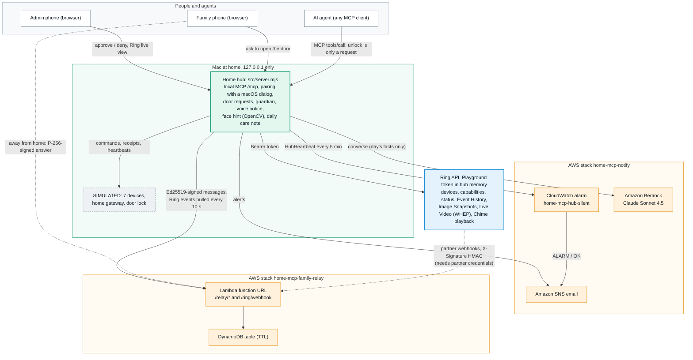
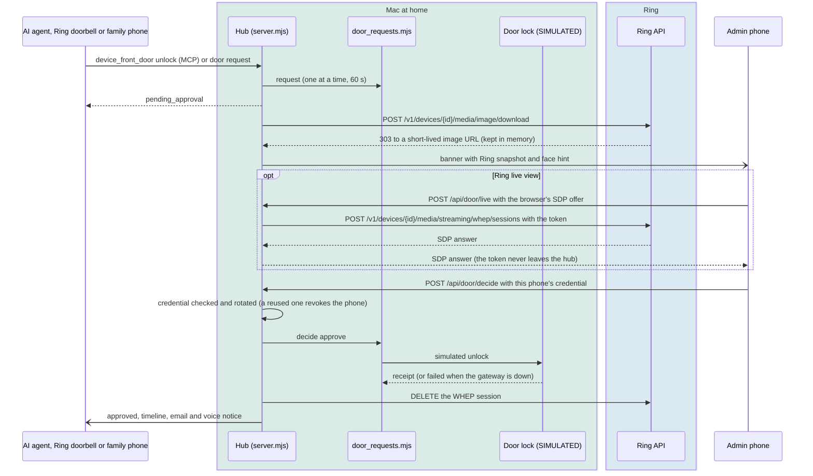
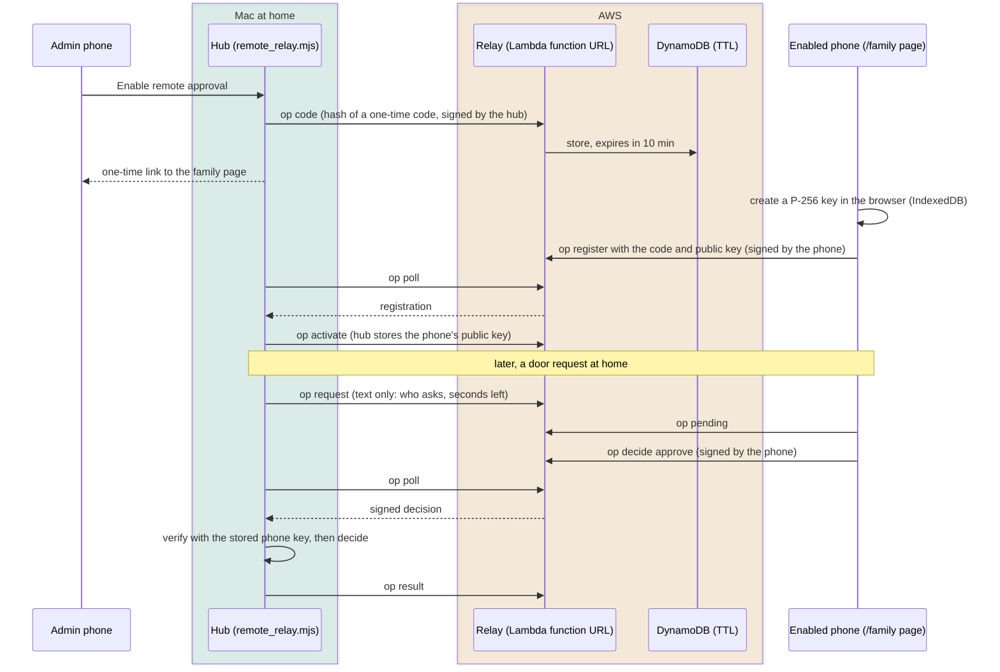
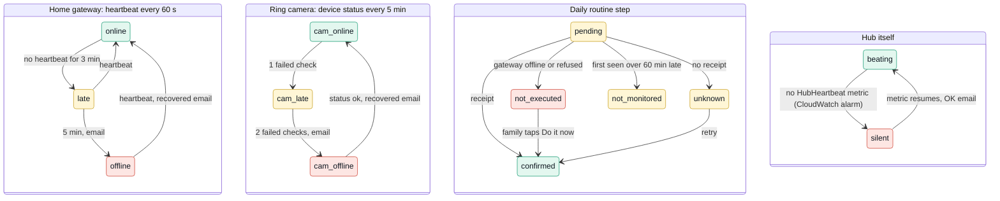
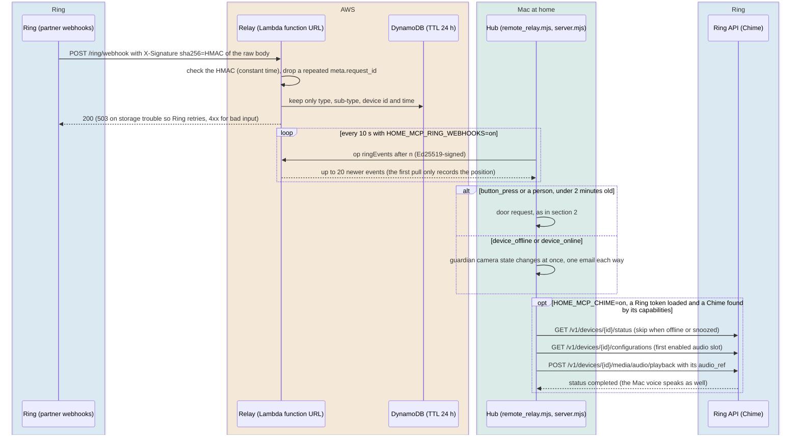

# Architecture

Five views of Home MCP Guardian, kept in sync with the code (file names in the boxes are real). GitHub renders these Mermaid diagrams directly. A one-page overview drawn for the README is [`system-overview.png`](system-overview.png) (source: [`diagrams/system-overview.html`](diagrams/system-overview.html)).

1. [System](#1-system) — what runs where
2. [Door approval](#2-door-approval) — the AI asks, a phone decides, Ring live view on the banner
3. [Remote approval](#3-remote-approval-family-relay) — approving from outside the home through the AWS family relay
4. [Guardian](#4-guardian) — how "something quietly stopped" is detected
5. [Ring webhooks and Chime](#5-ring-webhooks-and-chime) — Ring events for a hub behind NAT, and announcements on a Ring Chime

The earlier phase of the project (a cloud MCP chain with Cognito, API Gateway and a Mac worker that returns signed receipts) is shown in [`architecture.png`](architecture.png) and described in the README.

## 1. System

## 2. Door approval

The approving phone is the admin phone, or a phone the admin enabled for remote approval (section 3).

## 3. Remote approval (family relay)

The cloud only passes messages. The hub signs everything it sends with its Ed25519 key (public key pinned in the stack); each phone signs with its own non-extractable WebCrypto P-256 key; the hub verifies the phone's signature with the key it stored itself before anything opens.

## 4. Guardian

## 5. Ring webhooks and Chime

A hub at home sits behind NAT, so Ring's partner webhooks go to the relay's public `POST /ring/webhook`, and the hub pulls them over its signed channel. Real Ring deliveries need partner credentials with account linking, which our developer account does not have; this path was tested against the live relay with signed events shaped like Ring's documented examples (0.7–2.5 s from delivery to the hub). The Playground has no Chime: finding devices and their capabilities ran on the real Ring API, and playback is tested against the documented responses.

The same mailbox is published on its own as an MIT project, [ring-webhook-mailbox](https://github.com/jiarong0423/ring-webhook-mailbox) (CloudFormation template, client, tests).
